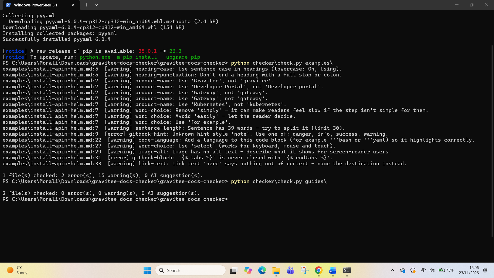
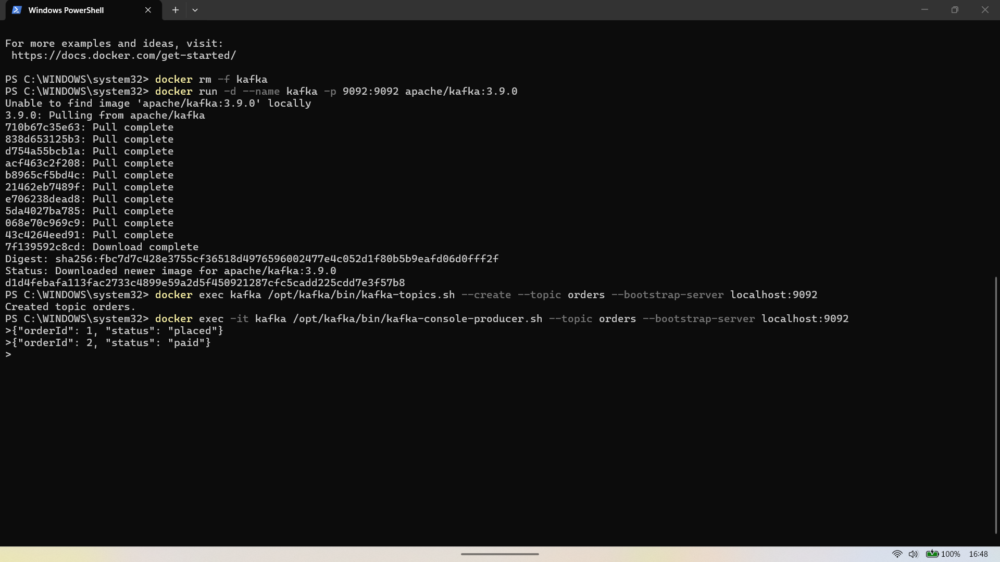
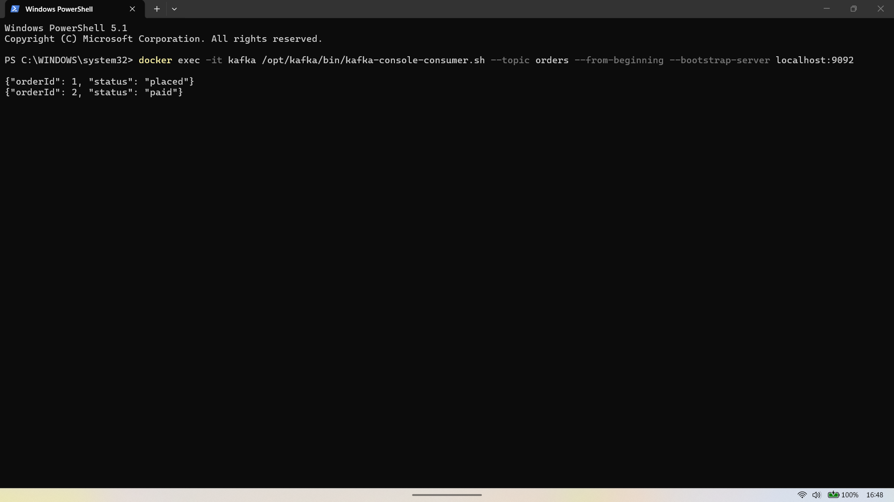
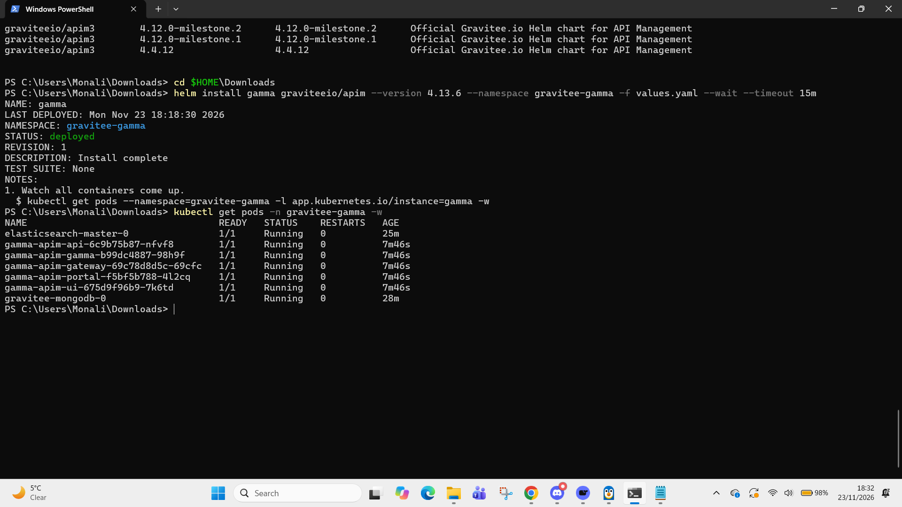
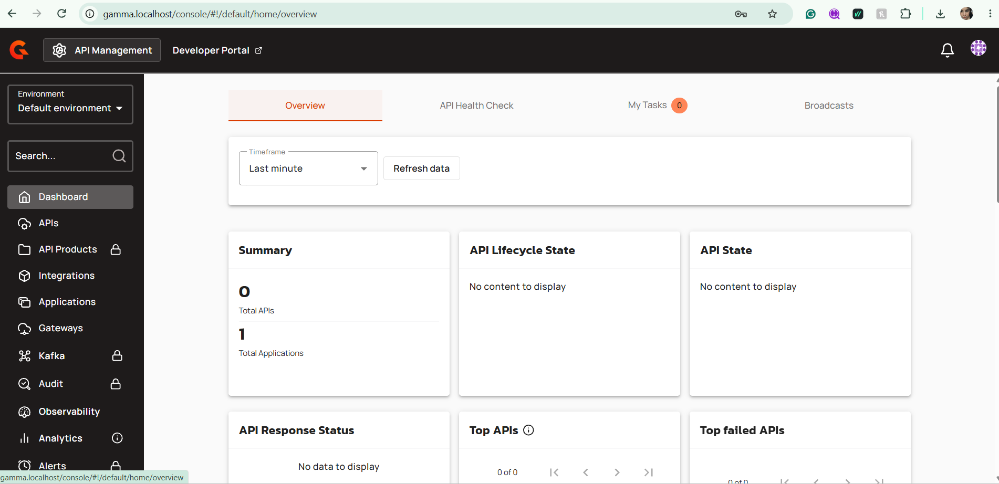

# Gravitee docs toolkit

A docs-as-code portfolio built around Gravitee-style documentation (GitBook Markdown). The idea: fix recurring docs problems at the source, so they don't come back.

| Part | What it is | Status |
|---|---|---|
| [Docs checker](checker/check.py) + [rules](rules.yaml) | Rule-based checker with an optional Claude review | ✅ Tested locally: catches the planted issues in a sample page; both guides pass |
| [GitHub Action](.github/workflows/docs-check.yml) | Runs the checker on every pull request | ✅ Tested: [see pull request #1](https://github.com/monaliguleria777-svg/gravitee-docs-toolkit/pull/1) |
| [Kafka guide](guides/expose-kafka-events-with-gravitee.md) | Run Kafka, then expose events through Gravitee | ✅ Part 1 tested on Windows with Docker (23 Nov 2026) · 🔄 Gravitee part needs a licence |
| [Kubernetes/Helm guide](guides/install-gravitee-on-kubernetes-with-helm.md) | Install Gravitee on a local Kubernetes cluster | ✅ Tested on Windows: Docker Desktop Kubernetes, Helm 4, chart 4.13.6 – all pods running, console login works (23 Nov 2026) |
| [Vale style](styles/Gravitee) | Same house rules for Vale | 🔄 Written; testing this week |
| [n8n workflow](n8n/README.md) | AI review: PR → Claude → one review comment | 🔄 Logic tested; full n8n run this week |

The guides are real content, the checker keeps them consistent, and n8n automates the review.

---

## Why

Docs reviews spend a lot of time on the same small issues: product names written three ways, unclosed `` blocks that break the page, images with no alt text, "click here" links. A script catches these in seconds. Human reviewers can then focus on what matters: is the page correct, complete and clear?

## How it works

| Layer | What it checks | Cost | Fails the build? |
|---|---|---|---|
| **Rule checks** | Product names (Gravitee, API Management, Developer Portal, Gateway…), filler words, "click on" → "select", GitBook blocks (`hint`, `tabs`, `code`, `stepper`) opened and closed with valid styles, sentence-case headings, sentence length, alt text, code-block languages, vague link text | Free, instant | Only for broken GitBook syntax |
| **AI review** (optional) | Judgement calls a script can't make: missing or out-of-order steps, prerequisites, unexplained jargon, incomplete code samples | One API call per page | Never – suggestions only |

The AI layer is built to be careful:
- It's told what the rule layer already covers, so it doesn't repeat it.
- It must cite a line number and a concrete fix for each issue.
- It must say "Check with engineering" instead of guessing product behaviour.
- A writer always makes the final call.

All rules live in [`rules.yaml`](rules.yaml), so writers can change them without touching code.

## Run it

```bash
pip install pyyaml
python checker/check.py examples/
```

Output on [`examples/install-apim-helm.md`](examples/install-apim-helm.md), a deliberately flawed page:

```text
install-apim-helm.md:5   [warning] heading-case: Use sentence case in headings (lowercase: On, Using).
install-apim-helm.md:7   [warning] product-name: Use 'Kubernetes', not 'kubernetes'.
install-apim-helm.md:9   [error]   gitbook-hint: Unknown hint style 'note'. Use one of: danger, info, success, warning.
install-apim-helm.md:31  [error]   gitbook-block: '' is never closed with ''.
...
1 file(s) checked: 2 error(s), 15 warning(s), 0 AI suggestion(s).
```

For the optional AI review: `pip install anthropic`, set `ANTHROPIC_API_KEY`, and add `--ai`.

## In CI

The [GitHub Action](.github/workflows/docs-check.yml) checks only the Markdown files changed in a pull request and shows the results on the exact lines. [Pull request #1](https://github.com/monaliguleria777-svg/gravitee-docs-toolkit/pull/1) shows it catching the planted errors.

## Where the rules come from

- **Confirmed** from Gravitee's public docs (Nov 2026): GitBook block syntax, product names as written in page titles, and the fork → branch → pull request contribution flow.
- **Assumed** from common developer-docs practice (Google and Microsoft style guides): word choice, sentence case, sentence length, alt text and link text. Gravitee's own style guide page wasn't online when I built this, so these are defaults to adjust to the team's real guide.

## Proof

| Test | Screenshot |
|---|---|
| Docs checker run locally |  |
| Kafka in Docker: sending events (producer) |  |
| Kafka in Docker: events received (consumer) |  |
| Gravitee on Kubernetes: all pods running |  |
| Signed in to the Gravitee console |  |

## Next steps

- [x] Test the Kubernetes/Helm guide hands-on
- [ ] Expose a Kafka topic through Gravitee's Event Gateway (needs a licence)
- [ ] Run the n8n workflow end to end and add a screenshot
- [ ] Run the Vale rules and add Vale to the GitHub Action
- [ ] Check that relative links and image paths exist
